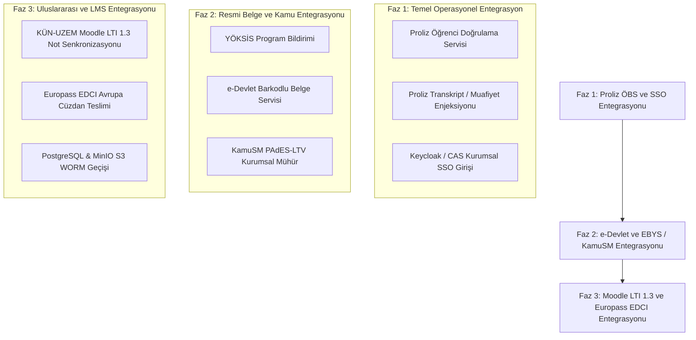

# KÜN-MYYS Proliz ÖBS ve Dış Sistemler Entegrasyon Analizi

Bu doküman; Kapadokya Üniversitesi Öğrenci İşleri Daire Başkanlığı tarafından kullanılan **Proliz Öğrenci Bilgi Sistemi (ÖBS)**, ulusal kamu sistemleri (YÖKSİS, e-Devlet, EBYS) ve kurumsal altyapıların KÜN-MYYS ile tam entegre çalışabilmesi için gereken teknik gereksinimleri, eksik servisleri ve API sözleşmelerini tanımlar.

---

## 1. Proliz ÖBS Entegrasyon Mimarisi ve Eksikler

Şu anki KÜN-MYYS prototipinde öğrenci ve intibak verileri yerel SQLite veri tabanında izole olarak yönetilmektedir. Sistemin üniversitenin birincil kayıt otoritesi olan **Proliz ÖBS** ile konuşabilmesi için 4 ana servis adaptörünün kurulması zorunludur:

```
┌─────────────────┐       REST / SOAP        ┌───────────────────────┐
│                 │  1. Öğrenci Doğrulama   │                       │
│                 │ ──────────────────────>  │                       │
│    KÜN-MYYS     │  2. Muafiyet / İntibak   │      Proliz ÖBS       │
│  (Mikro Yeter-  │ ──────────────────────>  │  (Öğrenci İşleri D.B. │
│   lilik Portalı)│  3. Transkript Dipnotu   │   Veri Tabanı & API)  │
│                 │ <─────────────────────>  │                       │
│                 │  4. %10 Kümülatif Kontrol│                       │
└─────────────────┘                          └───────────────────────┘
```

### A. Öğrenci Doğrulama ve Kayıt Eşleştirme Servisi (Student Lookup API)
* **Mevcut Durum:** Öğrenci programa kaydolurken T.C. Kimlik no ve e-posta formdan elle girilmekte, sistem öğrencinin üniversitede gerçekten aktif bir öğrenci olup olmadığını yerel olarak varsaymaktadır.
* **Gereksinim:**
  - `GET /api/proliz/ogrenci-sorgula?tc={TCKN}` veya SOAP `OgrenciBilgisiGetir` servisi.
  - Öğrencinin KÜN'de **aktif/kayıtlı** olup olmadığı, hangi fakülte/bölümde olduğu, danışmanı ve sınıf düzeyi Proliz'den anlık teyit edilmelidir.
  - **Kurum Dışı Öğrenen (Misafir)** ile **Kurum İçi Öğrenci** ayrımı Proliz sorgusuyla otomatik belirlenmelidir.
* **Örnek İstek & Yanıt Şeması:**
  ```json
  // GET /api/v1/integrations/proliz/students/11111111111
  {
    "status": "SUCCESS",
    "student_number": "220101045",
    "national_id": "11111111111",
    "full_name": "Ayşe Örnek",
    "faculty": "Bilişim ve Yapay Zekâ Fakültesi",
    "department": "Yazılım Mühendisliği",
    "degree_level": "LISANS",
    "total_curriculum_ects": 240,
    "completed_ects": 60,
    "registration_status": "ACTIVE",
    "advisor_email": "danisman@kapadokya.edu.tr"
  }
  ```

---

### B. Transkript Kredi İntibakı & Ders Muafiyeti Aktarımı (Exemption & Transcript Injection)
* **Mevcut Durum:** Birim kurulu ve Senato intibak kararını vermekte, ancak bu karar sadece KÜN-MYYS veri tabanında kalmaktadır.
* **Gereksinim:**
  - `POST /api/proliz/muafiyet-aktar` servisi.
  - Onaylanan mikro yeterlilik kredisinin öğrencinin Proliz transkriptine **"MU (Muaf)"** harf notuyla, ders eşdeğerliğiyle veya serbest seçmeli ders olarak otomatik yazılması gerekir.
  - Proliz'deki transkript dipnotuna resmi **KÜN-MYYS Belge Doğrulama Kodu** ve Ed25519 doğrulama URL'si işlenmelidir.
* **Örnek Proliz Muafiyet Enjeksiyon Paketi:**
  ```json
  // POST /api/v1/integrations/proliz/exemptions
  {
    "student_number": "220101045",
    "academic_year": "2026-2027",
    "semester": "GUZ",
    "exemption_type": "MICRO_CREDENTIAL",
    "credential_code": "KUN-MY-2026-000001",
    "verification_url": "https://mikro.kapadokya.edu.tr/api/verify/6xmUOqvkADsDT6N6FO3SiS18oG9tZEbd",
    "target_course_code": "SEC-401",
    "target_course_title": "Yapay Zekâ Uygulamaları",
    "recognized_ects": 2,
    "letter_grade": "MU",
    "senate_decision_number": "2026/18-04",
    "senate_decision_date": "2026-09-20"
  }
  ```

---

### C. YÖK %10 Kuralının Proliz Geçmişiyle Çapraz Doğrulanması (Cumulative Cap Check)

* **Mevcut Durum:** Sistem, başvurulan programın 240 veya 120 AKTS'nin %10'unu geçip geçmediğini matematiksel olarak denetler, ancak öğrencinin Proliz'deki geçmiş dönemlerinde başka bir muafiyet alıp almadığını bilmez.
* **Gereksinim:**
  - `GET /api/proliz/ogrenci-transkript-ozet?tc={TCKN}`
  - Öğrencinin Proliz transkriptindeki toplam kazanılmış AKTS'si ve daha önce intibak ettirilen dersleri çekilmeli; **kümülatif intibakın %10'u aşmadığı** Proliz verisi üzerinden teyit edilmelidir.
  - Lisans öğrencisi için toplam tanınan mikro yeterlilik kredisi **24 AKTS**, ön lisans için **12 AKTS** tavanını aşarsa sistem aktarımı otomatik olarak reddetmelidir.

---

### D. Harç / Ödeme ve Mali Kayıt Kontrolü (Finansal Doğrulama)

* **Mevcut Durum:** Ücretli veya kurum dışı eğitimlerde ödeme mekanizması sistemde sadece bayrak (`fee: 0`) olarak yer alır.
* **Gereksinim:**
  - Proliz Sanal POS veya üniversite muhasebe sistemiyle entegre olup eğitim ücretini ödeyen öğrencinin durumunun otomatik onaya düşmesi.

---

## 2. Kamu ve Kurumsal Doğrulama API Eksikleri

| Dış Sistem / Kurum | Eksik Olan Entegrasyon | Projedeki Mevcut Karşılığı | Çözüm / Gereken Adaptör |
|---|---|---|---|
| **YÖKSİS / ABAYS** | Senatodan onaylanan mikro yeterlilik programlarının YÖK sistemine bildirilmesi ve resmi YÖKSİS program kodu alınması. | Sistemde yerel `KUN-MY-2026-001` kodu üretiliyor. | `YÖKSİS Web Servis İstemcisi`: Senato onaylandığında SOAP `ProgramKaydet` çağrısı yapılması. |
| **e-Devlet Kapısı** | Düzenlenen mikro yeterlilik belgelerinin turkiye.gov.tr üzerinde *"Kapadokya Üniversitesi Mikro Yeterlilik Belgesi Sorgulama"* hizmeti olarak listelenmesi ve e-Devlet barkodu üretilmesi. | Kendi doğrulama motorumuz (`/api/verify/:code`) ve W3C JSON-LD çıktısı var; e-Devlet servis entegrasyonu henüz bağlı değil. | `e-Devlet Barkodlu Belge Servisi`: Kamu İhale ve e-Devlet entegrasyon protokolü ile XML/JSON servis uç noktası açılması. |
| **EBYS (Elektronik Belge Yönetimi)** | Akademik Birim ve Senato onay kararlarının resmi EBYS evrak sayısı ve tarih damgasıyla eşleştirilmesi. | Kararlar sistem içi kullanıcı ID ve zaman damgasıyla imzalanıyor; EBYS evrak numarası alanı eksik. | `EBYS REST Adaptörü`: Karar onaylandığında EBYS'den resmi evrak numarası ve barkod alma. |
| **KamuSM / Nitelikli E-İmza (PAdES-LTV)** | PDF sertifikaların resmi rektörlük/dekanlık KamuSM nitelikli elektronik sertifikasıyla mühürlenmesi. | Ed25519 eliptik eğri dijital imzası uygulanıyor (W3C standardı), fakat 5070 sayılı kanuna uygun PAdES PDF e-mührü henüz yok. | `KamuSM / PAdES İstemcisi`: Rektörlük kurumsal e-mührü ile PDF/A-1b belgelerini zaman damgasıyla mühürleme. |
| **Merkezi SSO (Keycloak / CAS / Proliz SSO)** | Personel ve öğrencilerin üniversite kurumsal e-postası ve şifresiyle (LDAP/OIDC) giriş yapması. | Yerel e-posta ve Scrypt şifre tablosu kullanılıyor. | `OIDC / SAML 2.0 Adaptörü`: Keycloak veya üniversite CAS sunucusuna bağlanma. |
| **KÜN-UZEM / Moodle LMS (LTI 1.3)** | Uzaktan eğitimlerde öğrencinin video izleme süresi (%80 devam) ve quiz notlarının Moodle'dan otomatik çekilmesi. | Ölçme değerlendiricisi notu ve devamı KÜN-MYYS arayüzünden elle girmektedir. | `LTI 1.3 Advantage & Moodle REST API`: Not defteri (Gradebook) ve devam durumu senkronizasyonu. |
| **Europass EDCI** | Avrupa Dijital Kimlik Cüzdanına elektronik mühürlü teslim. | W3C VC 2.0 ve Open Badges 3.0 üretiliyor. | `Europass ELM Adaptörü`: Avrupa Komisyonu EDCI Gateway uygunluk testlerinin tamamlanması. |

---

## 3. Mimari ve Güvenlik Altyapı İhtiyaçları (Üretime Geçiş)

1. **Veri Tabanı Katmanı (PostgreSQL Geçişi):**
   - *Mevcut Durum:* SQLite (`data/kun-myys.sqlite`).
   - *Hedef:* Eşzamanlı yüzlerce öğrenci, eğitici ve komisyon üyesinin güvenle işlem yapabilmesi için master-replica mimarisinde **PostgreSQL 16+** kümesine geçilmelidir.
2. **Öğrenme Kanıtı Depolama (S3 / MinIO Object Lock):**
   - *Mevcut Durum:* Sunucu yerel dosya sistemi (`storage/evidence/`).
   - *Hedef:* Sınav kayıtları, portfolyolar ve öğrenme kanıtlarının yasal saklama sürelerince tahrif edilmesini önlemek için **WORM (Write Once Read Many) / Object Lock** özellikli S3/MinIO depolama kullanılmalıdır.
3. **Kriptografik Donanım Güvenliği (HSM / KMS):**
   - *Mevcut Durum:* Ed25519 özel anahtarı sunucu diskinde `.pem` dosyasında durmaktadır (`data/keys/issuer-ed25519-private.pem`).
   - *Hedef:* Kurumun dijital imza anahtarı donanımsal bir **HSM (Hardware Security Module)** veya bulut KMS modülü içine alınmalı; özel anahtarın dışarı sızması imkansız kılınmalıdır.

---

## 4. Entegrasyon Yol Haritası (Fazlar)



### Faz 1: Temel Operasyonel Entegrasyon (Öğrenci İşleri & Proliz)
1. Proliz veri tabanı/web servisi için yetkili servis kullanıcısı ve IP izinlerinin alınması.
2. KÜN-MYYS içine `src/integrations/proliz.js` servis katmanının yazılması.
3. Öğrenci kayıt esnasında Proliz üzerinden aktiflik teyidi.
4. Başarı belgesi düzenlenen öğrencinin transkriptine Proliz muafiyet kaydının düşülmesi.
5. Kurumsal e-posta / SSO (Keycloak/LDAP) ile şifresiz kurumsal girişin açılması.

### Faz 2: Resmi Belge ve Kamu Entegrasyonu
1. e-Devlet Kapısı için SOAP/REST XML çıktı protokolünün hazırlanması.
2. EBYS evrak numarası ve tarihinin KÜN-MYYS onay akışına entegre edilmesi.
3. KamuSM nitelikli e-mühür kütüphanesinin (TR-E-İmza) PDF üretim motoruna bağlanması.

### Faz 3: LMS ve Uluslararası Cüzdan Entegrasyonu
1. Moodle LTI 1.3 Advantage servislerinin bağlanarak devam ve sınav notlarının otomatik çekilmesi.
2. Europass EDCI elektronik mühürleme ve doğrulama testlerinin tamamlanması.
3. SQLite'tan PostgreSQL ve MinIO S3 nesne depolamaya veri göçü.
