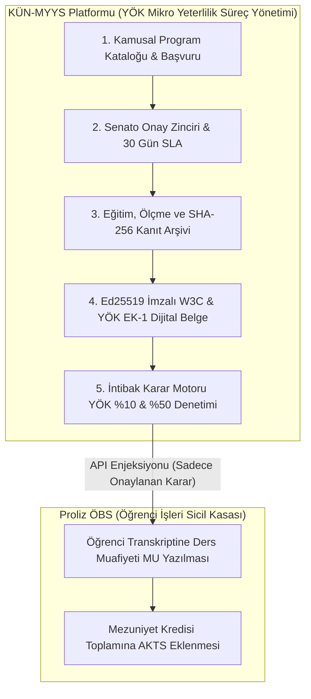

# KÜN-MYYS İş Değeri, Süreç Mimarisi ve Proliz Rol Dağılımı

Bu doküman; Kapadokya Üniversitesi Mikro Yeterlilik Yönetim Sistemi'nin (**KÜN-MYYS**) kurumsal operasyonlarda nerede konumlandığını, üniversite birimlerinin hangi iş yüklerini ortadan kaldıracağını ve mevcut Öğrenci Bilgi Sistemi (**Proliz ÖBS / SIS**) ile olan iş bölümünü açıklar.

---

## 1. Temel Problem: Neden `sis.kapadokya.edu.tr` Yönlendirmesi Yetersizdir?

Eski/canlı web sitesindeki (`mikro.kapadokya.edu.tr`) her işlem butonunun doğrudan `sis.kapadokya.edu.tr` (Proliz giriş ekranı) sayfasına yönlendirmesi kurumsal ve operasyonel açıdan iki büyük tıkanıklık yaratmaktadır:

1. **Kurum Dışı Öğrenenler İçin Sistem Duvarı:**
   Mikro yeterlilikler yalnızca kayıtlı üniversite öğrencilerine değil; mezunlara, çalışan profesyonellere ve bireysel öğrenenlere açıktır. Dışarıdan bir mühendis, sağlık çalışanı veya mezun siteye geldiğinde karşısına çıkan Proliz giriş ekranı (Öğrenci No / Şifre) nedeniyle sisteme adım dahi atamaz.
2. **Proliz'in Tasarım Amacı Dışında Kalması:**
   Proliz klasik bir **Öğrenci Bilgi Sistemi (ÖBS)**’dir; 14 haftalık örgün yarıyılları, vize-final sınavlarını, harçları ve diploma mezuniyet süreçlerini takip eder. Ancak YÖK'ün 2026 tarihli *Mikro Yeterlilikler Çerçevesi* uyarınca zorunlu kılınan; **Bloom taksonomisi çıktıları, 25 saat=1 AKTS kural motoru, öğrenme kanıtı arşivi (SHA-256), W3C Verifiable Credentials ve Open Badges 3.0 üretimi** Proliz'in kapsamı ve yetenekleri dışındadır.

---

## 2. KÜN-MYYS ile Proliz Arasındaki Rol Dağılımı ve Mimari

**KÜN-MYYS, Proliz'in bir alternatifi veya rakibi değildir.** KÜN-MYYS; eğitim tasarımından sınav kanıtlarına, dijital belgelendirmeden Senato intibak kararına kadar olan süreci yöneten **"Mikro Yeterlilik Fabrikası"**, Proliz ise sürecin en sonunda intibak kararını transkripte işleyen **"Resmi Sicil Kasası"**dır.

---

## 3. Üniversitenin Hangi İşleri Kolaylaşacak? (Birim Bazında Değer Analizi)

### A. Öğrenci İşleri Daire Başkanlığı
* **Manuel Dilekçe ve Evrak Trafiği Biter:** Öğrencinin aldığı kurs sertifikasını fakülte sekreterliğine elden götürmesi, bölüm kurulunun toplanması, dekanlık onayının çıkması ve evrakın elden Öğrenci İşlerine gelmesi haftalar süren bir bürokrasidir. KÜN-MYYS'de bu akış tamamen dijitalleşir.
* **YÖK %10 ve %50 Hesaplama Hataları Sıfırlanır:** Bir memurun öğrencinin aldığı kredinin mezuniyet AKTS'sinin %10'unu aşıp aşmadığını veya uzaktan eğitim sınırını (%50) hesap makinesiyle hesaplamasına gerek kalmaz. Sistem sınır aşımlarını **otomatik olarak kilitler.**
* **30 Günlük Karar Takvimi Garantisi:** YÖK mevzuatı (Madde 9) intibak kararının azami 30 takvim gününde verilmesini emreder. Sistemde yer alan canlı geri sayım sayacı sayesinde gecikmeler engellenir.
* **Proliz'e Hatasız Veri Aktarımı:** İntibak onaylandığında Proliz transkriptine tek bir API çağrısıyla *"MU (Muaf)"* kodu ve belge doğrulama bağlantısı doğrudan işlenir.

### B. Akademik Birimler, Komisyon ve Senato
* **Standartlara Dayalı Program Tasarımı:** Bir öğretim üyesi yeni bir eğitim açmak istediğinde;
  - Bloom düzeyli öğrenme çıktıları (Analiz, Değerlendirme, Yaratma),
  - 25 saat = 1 AKTS kuralına göre iş yükü dağılımı (Teorik, Laboratuvar, Proje),
  - Ölçme matrisi (Hangi sınav hangi çıktıyı ölçüyor?),
  KÜN-MYYS üzerinde adım adım doldurulur. Kriterler sağlanmadan program onaya sunulamaz.
* **Dijital Onay Zinciri:** Koordinatör → Akademik Birim Kurulu → Mikro Yeterlilik Komisyonu → Senato onay akışı fiziksel imza ve EBYS yazışma yükü olmadan saniyeler içinde tamamlanır.

### C. Eğiticiler ve Ölçme Değerlendiricileri
* **Öğrenme Kanıtı Arşivleme Güvencesi:** YÖK kurallarına göre mikro yeterlilik belgesi verilebilmesi için öğrencinin sınav kağıdı, proje dosyası veya kod reposunun **kanıtı** saklanmalıdır. Proliz'de sadece harf notu tutulur, dosya arşivi tutulamaz. KÜN-MYYS'de tüm kanıtlar SHA-256 kriptografik özetiyle mühürlenerek saklanır.
* **Bütüncül Başarı Kontrolü:** Sistem; devam oranı (%80), başarı notu (en az 60) ve tüm öğrenme çıktılarının rubrik kanıtı sisteme yüklenmeden öğrenciyi `BAŞARILI` durumuna geçirmez.

### D. Öğrenenler (Öğrenciler, Mezunlar, Sektör Profesyonelleri)
* **Engelsiz Başvuru:** Sisteme kayıt olmak için KÜN öğrencisi olma zorunluluğu yoktur; sektörden bir mühendis de doğrudan e-postasıyla kayıt olabilir.
* **Uluslararası Dijital Kimlik & Rozet:** Katılımcı eğitimi tamamladığında eline sadece bir kağıt parçası verilmez. **W3C Verifiable Credentials** ve **Open Badges 3.0** formatında, Ed25519 kriptografik imzalı, LinkedIn profiline eklenebilen ve AB Dijital Kimlik Cüzdanlarına yüklenebilen küresel bir belge edinir.

### E. YÖKAK ve Kalite Güvencesi Ofisi
* **Denetim Kolaylığı:** Kurumsal akreditasyon denetimlerinde müfettişler:
  - Senato onay kararlarını sistemin değişmez denetim zincirinden (audit trail) inceleyebilir.
  - Sınav kanıtlarının geriye dönük değiştirilmediğini SHA-256 özet zincirinden teyit edebilir.
  - Başarı, katılım ve geri bildirim SLA kalite göstergelerini anlık rapor olarak alabilir.

---

## 4. Karşılaştırma Matrisi: Proliz Tek Başına vs. KÜN-MYYS + Proliz

| Özellik / Süreç | Proliz ÖBS Tek Başına | KÜN-MYYS + Proliz Entegre Modeli |
|---|---|---|
| **Eğitim Tanıtımı & Vitrin** | Yok (Sadece parola giriş ekranı var) | **Kamuya açık, filtreli ve modern vitrin** |
| **Kurum Dışı Öğrenen Kabulü** | İmkansız (Öğrenci numarası şart) | **Tüm öğrenenlere açık e-posta ile kayıt** |
| **Bloom Çıktı & İş Yükü Tasarımı**| Desteklemez | **25 saat = 1 AKTS kural motoruyla güvenceli** |
| **Onay Süreci Yönetimi (SLA)** | Manuel EBYS yazışması | **4 kademeli dijital onay ve 30 gün sayacı** |
| **Sınav Kanıtı Arşivi** | Yok (Sadece nihai not girilir) | **SHA-256 kriptografik kanıt kütüğü** |
| **YÖK %10 & %50 İntibak Denetimi**| Memur tarafından elle hesaplanır | **Sistem tarafından otomatik denetlenir ve kilitlenir** |
| **Dijital Rozet ve W3C Belgesi** | Yok (Yalnızca standart PDF) | **Ed25519 imzalı W3C VC 2.0 & Open Badges 3.0** |
| **Kamuya Açık Karekod Doğrulama**| Yok | **Anında Ed25519 eliptik eğri doğrulaması** |
| **Transkripte Muafiyet Yazma** | **Proliz'in temel uzmanlığıdır** | **KÜN-MYYS onaylar, Proliz transkripte yazar** |

---

## 5. Özet Sonuç

KÜN-MYYS, üniversitenin eğitim tasarımı, kalite güvencesi, öğrenme kanıtı arşivi ve YÖK mevzuat uyumunu üstlenen **akademik motorudur.** Proliz ise Öğrenci İşleri Dairesi'nin yasal transkript kütüğünü tutan **sicil sistemidir.** 

İki sistem entegre çalıştığında; ziyaretçiler login duvarına çarpmadan programları keşfedip başvurur, fakülteler dijital ortamda program tasarlar, hocalar sınav kanıtlarını yükler, öğrenci W3C dijital belgesini alır ve Senato onayladığı an Proliz transkriptine muafiyet notu tek tıkla işlenir.
